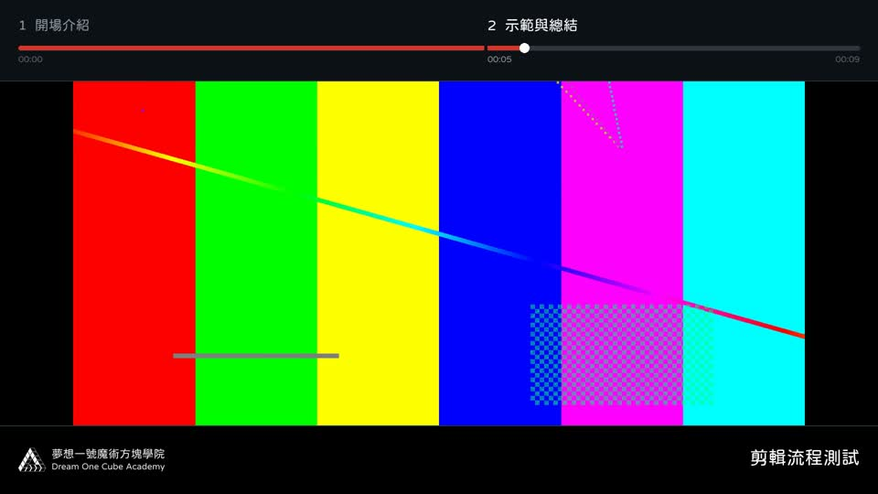
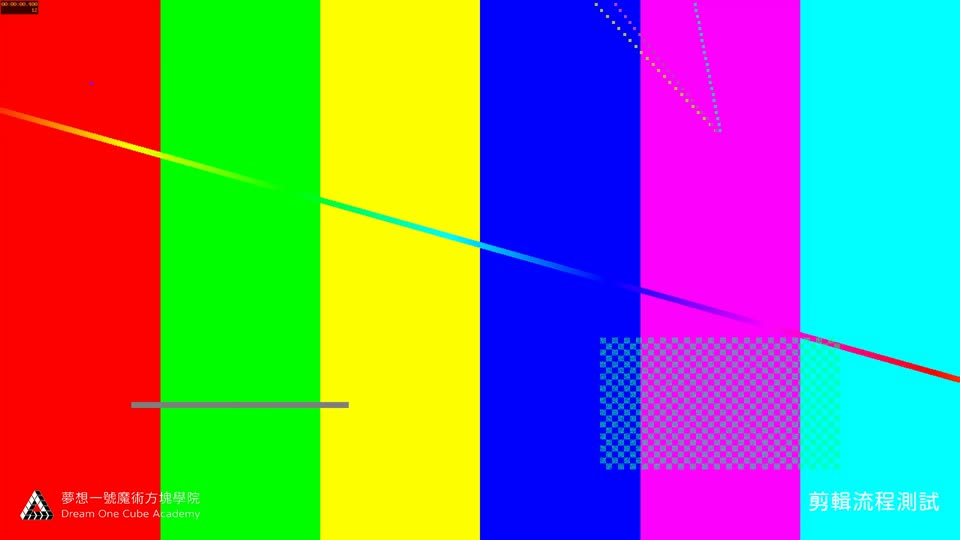

# 夢想一號影片剪輯 Skill 交付驗證

來源：Claude 對話「大師不藏私剪輯」的 dreamone-video-cut.zip。原包保留在本機，本次整理到 dreamone-skills 的 skills/dreamone-video-cut。

## 內容

保留九步流程、五支腳本、通用剪輯規則與分層詞彙表。補齊夢想一號白字 Logo 原檔及粉圓體 1.1；字型與官方 blob SHA 相符，附 SIL OFL 授權。預設設定改為一般教學影片，斜轉詞彙表仍可選用。

修正字幕清理誤刪正常詞、編碼分段造成重複字幕、SRT 毫秒進位、章節交界進度點及 FFmpeg 失敗回報。串接成功後會將 SRT／TXT 放到成品同層。CoWork 舊環境限制標示為歷史條件，避免套用到其他工具。

## 實測

- Python 3.14、FFmpeg 8.1.1，獨立虛擬環境。
- 用合成測試素材跑量音量 → 規劃 → 編碼 → 串接 → 六格截圖；混合 1080p／1440p，含一秒跳剪，成品約 9.02 秒。
- 章節條與底部 CC 區的四種開關組合均通過，逐一看圖；輸出均為 1920×1080、30 fps、H.264。
- book、嘻哈、呵護等原句保留；字幕跨編碼單元沒有重複，刪除片段不出字幕；時間碼在秒／分進位正常。
- SRT／TXT 與 mp4 放在同層；故意使用不存在的素材時，試剪正確回傳失敗。
- Skill frontmatter 驗證通過。ASR 的 sherpa-onnx 依賴匯入與 WAV 格式檢查通過；本次未下載約 1 GB 的完整模型重跑辨識，因此不宣稱辨識品質已重新驗證。

## 測試畫面

章節條與底部 CC 區開啟：

兩區皆關閉：

